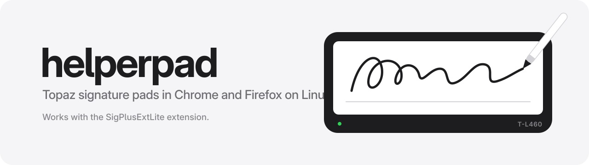

<p align="center"></p>

| Section | What's there |
|---|---|
| [Install](#install) | One line that installs everything |
| [Update](#update) | Get the newest version |
| [Manual install](#manual-install) | The same setup by hand |
| [Test](#test) | Try a signature on Topaz's demo page |
| [Docs](#docs) | Commands, logs, troubleshooting, and more |
| [License](#license) | MIT |

## Install

```
curl -fsSL https://raw.githubusercontent.com/DrianeDiojanPerez/helperpad/master/install.sh | sh
```

## Update

```
helperpad update
```

Or press **Update now** in the signing window when it says a newer release exists. Then close the browser completely and open it again.

## Manual install

1. Give your user access to the pad (once, needs `sudo`):
   ```
   sudo tee /etc/udev/rules.d/70-topaz-sigpad.rules >/dev/null <<'EOF'
   SUBSYSTEM=="hidraw", ATTRS{idVendor}=="06a8", ATTRS{idProduct}=="0043", TAG+="uaccess"
   SUBSYSTEM=="usbmisc", KERNEL=="hiddev*", ATTRS{idVendor}=="06a8", ATTRS{idProduct}=="0043", TAG+="uaccess"
   EOF
   sudo udevadm control --reload && sudo udevadm trigger
   ```
   Then unplug the pad and plug it back in.
2. Build and install the binary:
   ```
   cargo build --release
   install -Dm755 target/release/helperpad ~/.local/bin/helperpad
   ```
3. Register it with Chrome by saving this as `~/.config/google-chrome/NativeMessagingHosts/com.topaz.sigplusextlite.win.2.json` (use `chromium` in the path for Chromium), with your own home folder in `path`:
   ```
   {
     "name": "com.topaz.sigplusextlite.win.2",
     "description": "helperpad: Topaz SigPlusExtLite host for Linux",
     "path": "/home/you/.local/bin/helperpad",
     "type": "stdio",
     "allowed_origins": ["chrome-extension://dhcpobccjkdnmibckgpejmbpmpembgco/"]
   }
   ```
4. For Firefox, save this as `~/.mozilla/native-messaging-hosts/com.topaz.sigplusextlite.win.2.json` (Zen uses `~/.zen/`, LibreWolf `~/.librewolf/`), again with your own home folder in `path`. Skip this step if you only use Chrome:
   ```
   {
     "name": "com.topaz.sigplusextlite.win.2",
     "description": "helperpad: Topaz SigPlusExtLite host for Linux",
     "path": "/home/you/.local/bin/helperpad",
     "type": "stdio",
     "allowed_extensions": ["sigplusextliteff@topazsystems.com"]
   }
   ```
5. Install the Topaz SigPlusExtLite extension for [Chrome](https://chromewebstore.google.com/detail/topaz-sigplusextlite-exte/dhcpobccjkdnmibckgpejmbpmpembgco) or [Firefox](https://addons.mozilla.org/firefox/addon/topaz-sigplusextlite-extension/).
6. Close the browser completely and open it again. Do this after every install, because a helper that's already running keeps the old version.

Run `helperpad status` to check that everything is in place.

## Test

- Open Topaz's demo at https://sigplusweb.com/sign_chrome_ff_sigplusextlite.html, click **Sign**, sign on the pad, and press **OK**. The signature shows up on the page, with the SigString in the left box.

## Docs

- [How it works](docs/how-it-works.md)
- [Installing](docs/install.md): what the installer does, a package by hand, or from source
- [Updating](docs/update.md): what an update does
- [Commands](docs/commands.md): `helperpad` and `make`
- [Logs and where things live](docs/logs.md)
- [Troubleshooting](docs/troubleshooting.md)
- [Uninstall](docs/uninstall.md)
- [Supported commands](docs/supported-commands.md): what a website can ask for
- [Signature data](docs/signature-data.md): what goes back to the page, how it was checked, and limits
- [Releasing](docs/releasing.md)

## License

MIT. See [LICENSE](LICENSE).
